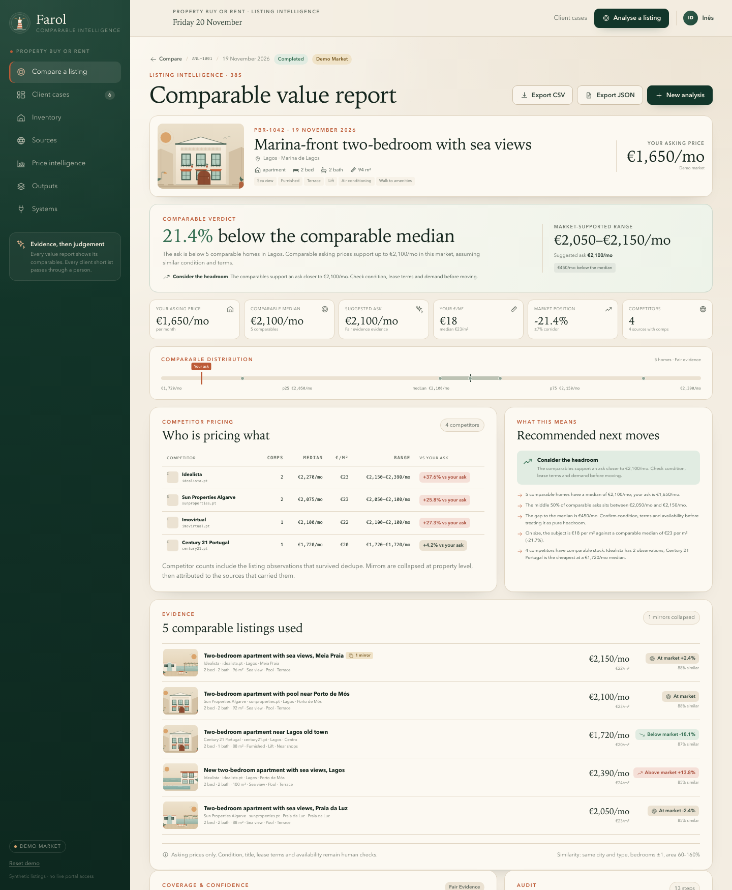

# Farol — demo runbook

A 3-minute walkthrough of the **listing-first comparable agent**. Give Farol one property, and it finds similar listings, groups the competition and returns a value range with evidence.

---

## Before you start

```bash
cd "search agent"
npm start
```

Open **http://127.0.0.1:4400**.

Two market modes are available:

- **Live market · Imovirtual** — fetches current public Imovirtual search results on demand. Needs outbound network access.
- **Demo market** — a deterministic synthetic catalogue. No network required.

The demo seeds itself with two completed demo analyses. Reset anytime:

```bash
curl -X POST http://127.0.0.1:4400/api/demo/reset \
  -H 'Content-Type: application/json' -d '{}'
```

or **Reset demo** in the sidebar.

---

## 1. The home page (20 seconds)

- The question is **“What is my listing worth?”**, not “what is the client looking for?”.
- **From my portfolio** is selected with **PBR-1042 — Marina-front two-bedroom with sea views, Lagos, €1,650/month**.
- **Live market · Imovirtual** is selected by default. The switch between Live and Demo is the first control.
- Point out the coverage: **20 catalogue sources · 92 demo listings · 1 live portal**.
- The **Latest read** panel shows a saved analysis. The **LIVE** / **DEMO** pill on each recent card tells you which market it used.

**Line to use:** “The unit of work is one listing and its comparable market — not a client brief.”

---

## 2. Run a live comparison (20 seconds)

Press **Find comparable listings**.

The agent streams:

1. read and normalise the listing;
2. plan the live market search;
3. fetch Imovirtual public results;
4. surface the agencies with comparable stock;
5. extract and normalise;
6. filter to similar homes;
7. collapse mirrors and filter seasonal short-lets;
8. build the median and range;
9. group competitors;
10. complete.

Live results change. At the time of the build, PBR-1042’s live read was **22.2% above** a live comparable median of about **€1,350/month**.

**Line to use:** “This is a live public search for the subject’s city, not a synthetic fixture. The values will move with the market.”

---

## 3. Read the report (60 seconds)



### Subject
- PBR-1042, 2 bed, 2 bath, 94 m², Lagos / Marina de Lagos, €1,650/month.
- The subject is one of the portfolio homes.

### Verdict
- In **Demo mode**, the seeded example is **21.4% below** the comparable median:
  - median **€2,100/month**
  - supported range **€2,050–€2,150/month**
  - suggested ask **€2,100/month**
  - recommendation **Consider the headroom**
- In **Live mode**, the same subject was **22.2% above** the live median of about **€1,350/month** at the time of capture:
  - this is a real market read, not a fixed demo number.

Switch to **Demo market**, then open **ANL-1001**, if you want the exact reproducible example.

### KPIs
- asking, median, suggested ask
- subject €/m² versus median €/m²
- market position
- number of competitors with comparable stock

### Distribution
- The band is p25–p75.
- The dark line is the median.
- The terracotta marker is your ask.
- Dots are individual comparables.

### Competitor pricing
- Demo: Idealista, Sun Properties, Imovirtual, Century 21 (synthetic observations).
- Live: OLX, HABITAZZA, Century 21 Realty Art II, Uniplaces and others (current Imovirtual agency listings).
- “Vs your ask” is the competitor median versus your price, not a market verdict.

### Evidence
- Every comparable is visible with source, size, €/m², similarity and mirror count.
- Seasonal short-lets and malformed sizes are filtered out in live mode.
- Open a row to show why it is similar.

### Recommended next moves
- Below median: condition, terms, a stale ask or genuine headroom?
- Above median: a premium the comparables cannot see, or negotiation room?
- Thin evidence is labelled “thin”, not turned into confidence.

**Line to use:** “The report gives a range and the evidence. It does not pretend to know condition or title.”

---

## 4. Change the subject (30 seconds)

Press **New analysis**.

1. Select **Enter a listing**.
2. Change the asking price to **€2,400**.
3. Keep everything else.
4. Run it in Demo mode for a deterministic result, or Live mode for the current market.

The verdict flips to **above market** in the demo. The suggested range and negotiation story change. This is the point of a listing-first tool: it values **your** property, not a generic search result.

---

## 5. Exports and audit (20 seconds)

- **Export CSV**: every comparable with source, price, €/m², delta, score and mirrors.
- **Export JSON**: the full report, including subject, competitor table, coverage, queries and recommendation.
- **How the report was built**: the full agent step log is retained.
- **Coverage & confidence**: sources planned, sources with comps, observations, mirrors, comparables and confidence.

**Line to use:** “This is auditable. You can trace the median back to the rows.”

---

## 6. Honest questions and answers

**“Does it browse the entire internet?”**
No. It has a **live Imovirtual adapter** that fetches current public search results for the subject city. It does not crawl every portal or the whole web. Additional sources need their own provider adapters or licensed feeds. The agent does not bypass logins or anti-bot controls.

**“Is the live data real?”**
Yes — the listings and prices come from Imovirtual’s public search page at request time. They can change, disappear or be stale. Confirm the source’s terms for your use.

**“Is the AI making the pricing decision?”**
No. It builds the comparable set and the range. A person decides whether a premium is justified or whether there is headroom.

**“Where do the prices come from?”**
Live mode: current Imovirtual asking prices. Demo mode: synthetic asking prices. Neither is a sold-price index.

**“Why do competitor medians differ from the overall median?”**
Each competitor row is the median of the observations attributed to that source. The overall median is across the full deduplicated comparable set.

**“What if there are no comparables?”**
The report says so, returns no suggested price and recommends widening coverage. It does not invent a valuation.

**“Why did a live run fail?”**
The source may be unavailable, rate-limited, blocking requests or returning no matching listings. Retry later or use Demo mode. The app surfaces the error rather than fabricating data.

**“Does the client shortlist workflow still exist?”**
Yes, under **Client cases**. It reuses the same search and price engines, but it is no longer the primary product.

---

## Reset between audiences

```bash
curl -X POST http://127.0.0.1:4400/api/demo/reset \
  -H 'Content-Type: application/json' -d '{}'
```

This clears analyses and restores the 20 portfolio homes, 92 demo market listings, 20 sources and two seeded demo value reports. It does not affect the live source.
