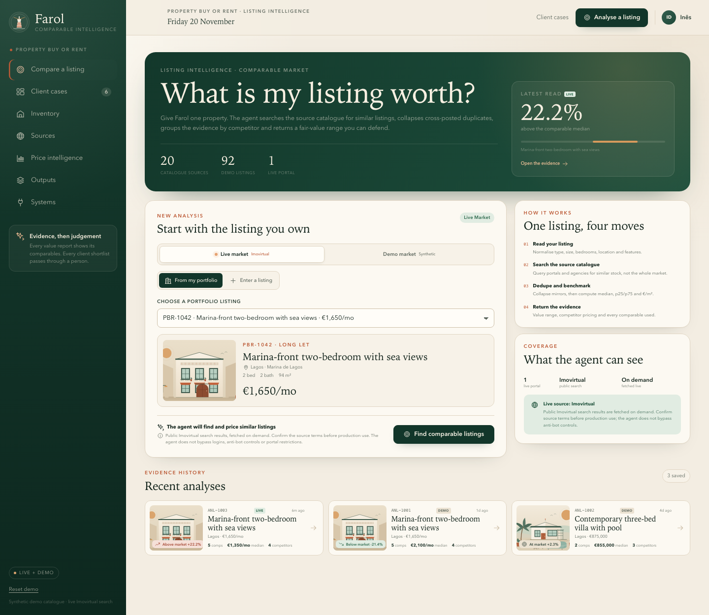
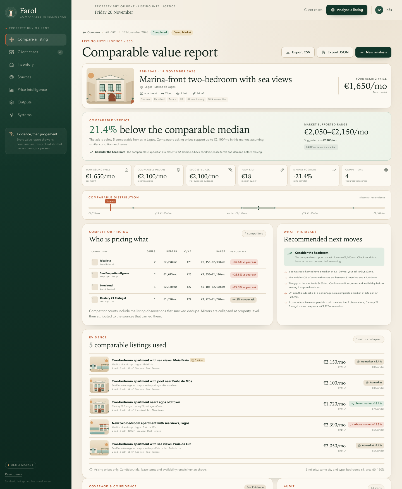
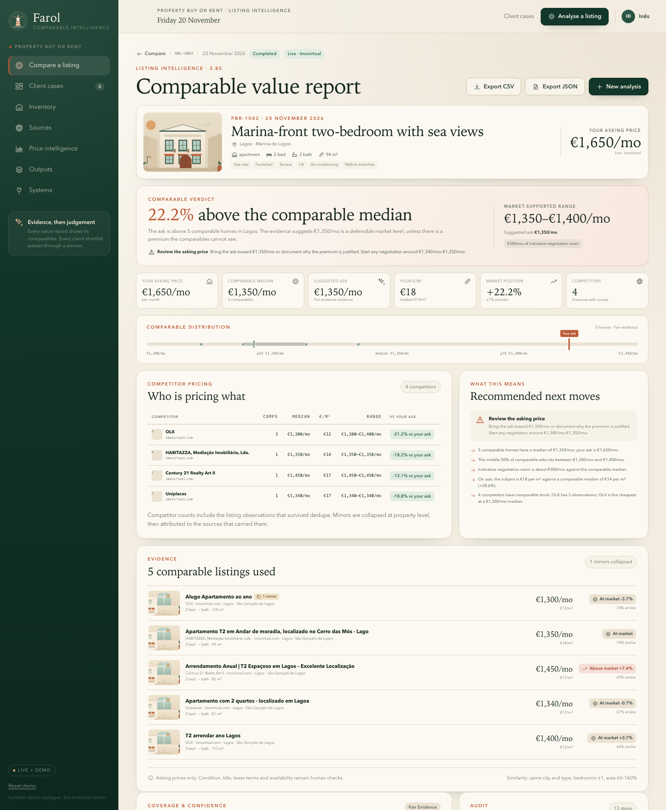
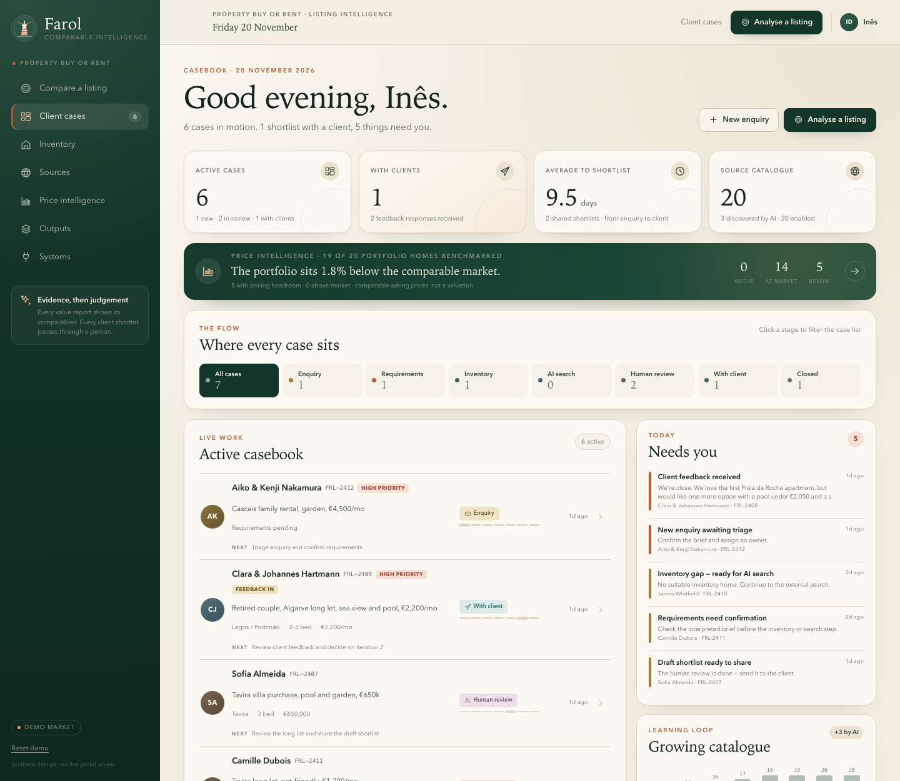

# Farol

**Give it one listing. It finds the comparable market, groups the competitors and returns a value report you can defend.**

Farol is a listing-first AI agent for property pricing. It takes a property you already own, searches the source catalogue for similar listings, removes cross-posted duplicates, excludes the listing's own mirrors, groups the evidence by competitor, and returns a comparable value range with every source attached.

It runs locally with **no dependencies and no external services** in demo mode.

```bash
cd "search agent"
npm start
# open http://127.0.0.1:4400
```

Node.js **24+** is required because Farol uses Node's built-in `node:sqlite`.



---

## The core loop

```text
Your listing
    │  type · city · bedrooms · area · asking price · features
    ▼
Read + normalise
    ▼
Search the source catalogue  ──►  portals, agencies, competitors
    ▼
Find similar listings
    ▼
Remove mirrors / deduplicate
    ▼
Value the segment  ──►  median · p25/p75 · €/m² · confidence
    ▼
Competitor breakdown  ──►  who is pricing high, low, and with what stock
    ▼
Value report  ──►  range, suggested ask, every comparable used
```

No brief, no client case, no shortlist required. The unit of work is **one listing and its comparable market**.

---

## What the report gives you



For the seeded PBR-1042 example:

- **Asking price:** €1,650/month
- **Comparable median:** €2,100/month from 5 similar Lagos apartments
- **Verdict:** 21.4% below the comparable median
- **Market-supported range:** €2,050–€2,150/month
- **Suggested ask:** €2,100/month
- **Competitors:** 4 sources with comparable stock, each with its own median, €/m² and range
- **Evidence:** every comparable listing, source, size, price per m², similarity score and mirror count
- **Confidence:** based on the number and quality of comparable evidence

The report is deliberately explicit about what it does **not** know: condition, title, lease terms, availability and the reason for a premium remain human checks.

---

## What is real, and what is demo

**Two market modes:**

| Mode | What it searches | Use it for |
|---|---|---|
| **Live market · Imovirtual** | Current public Imovirtual search results for the subject's city and transaction. One search page is fetched on demand. | A real, current read. Values change with the market. |
| **Demo market** | A deterministic synthetic catalogue of **92 unique listings, 98 source observations, 20 sources**. | Repeatable demos, tests and offline use. |

**Real in both modes:**

- The agent workflow: normalise → search → filter → dedupe → value → competitor grouping → report.
- The comparable engine: same city/type, bedrooms ±1, area 60–160%, median/p25/p75, price per m², confidence.
- Self-mirror exclusion: a subject is not compared against what looks like its own listing.
- Competitor aggregation and audit trail.
- SQLite persistence, streamed agent steps, exports and the UI.
- Source catalogue import/export, inventory, portfolio and the optional client casework.

**Live source boundary:**

- The live adapter currently covers **Imovirtual** only. It fetches a public search page, parses the structured listing payload, filters seasonal short-lets and caches the result for eight minutes.
- It does **not** crawl the entire internet, does not bypass logins or anti-bot controls, and does not fetch every portal.
- Confirm Imovirtual's terms for your use. Production should add licensed feeds/search APIs and explicit source policies.
- No Zoho record is written and no listing is published.

The Systems page states these boundaries explicitly.

### Live market example



This is a live Imovirtual comparison for PBR-1042. The subject was asking **€1,650/month**; at the time of capture the live comparable median was about **€1,350/month**, making the ask **22.2% above** the live market. Live values will change — that is the point.

---

## Why the engine is listing-first

The earlier build was organised around a client enquiry and a shortlist. That is still available under **Client cases**, but it is no longer the core.

The listing-first model is stronger for competitor/value work because:

- the subject is unambiguous (one property, one asking price);
- comparables do not depend on a buyer's must-haves;
- the same engine can value a portfolio of 20 homes or a single off-market listing;
- competitor analysis is a natural output, not a side effect;
- the report can be used for repricing, acquisition, seller conversations or a client shortlist.

The client casework remains useful as a downstream workflow: the same comparable evidence can support a shortlist when a buyer brief is in play.

---

## Quick start

```bash
cd "search agent"
npm start
```

Open **http://127.0.0.1:4400**.

The app seeds itself with:

- 20 portfolio listings to use as subjects;
- 92 unique market listings across 20 sources;
- 98 listing observations (mirrors included);
- two completed value reports so the home page has evidence immediately.

If a previous session changed the demo:

```bash
curl -X POST http://127.0.0.1:4400/api/demo/reset \
  -H 'Content-Type: application/json' -d '{}'
```

or use **Reset demo** in the sidebar.

---

## A 2-minute demo path

1. Open the home page. Point out the question: **“What is my listing worth?”**
2. Leave **From my portfolio** selected and keep **PBR-1042 — Marina-front two-bedroom with sea views, Lagos, €1,650/month**.
3. Leave **Live market · Imovirtual** selected and press **Find comparable listings**.
4. Watch the agent stream: read listing → plan live search → fetch Imovirtual → filter similar → collapse mirrors → build value range → group competitors → complete.
5. The live values change with the market. At the time of the build, the live read was **22.2% above** the live comparable median. Switch to **Demo market** and open **ANL-1001** to show the deterministic **21.4% below** example.
6. In **Competitor pricing**, show the live agency-level medians (or the demo portals) and make clear these are asking prices, not transactions.
7. Open the **Evidence** rows. Show the source, size, €/m², similarity score and mirror count.
8. Open **What this means**. This is the decision layer: condition and terms still need checking.
9. Switch to **Enter a listing**, change the price, and run it again. Show the verdict flip and the recommended range.
10. Use **Export CSV** to show that the evidence is portable.

The detailed runbook is in **[DEMO.md](DEMO.md)**.

---

## How the agent works

### 1. Read and normalise

The subject becomes a common shape:

- transaction (rent/sale)
- property type
- city and area
- bedrooms, bathrooms, size
- asking price and period
- features
- image and description

Portfolio subjects carry their reference (e.g. PBR-1042). Manual subjects are labelled “Your listing”.

### 2. Plan the comparable search

The agent builds query variants such as:

- `2-bed apartment for rent in Lagos`
- `apartment with Sea view Lagos asking prices`
- `similar apartment near Meia Praia for rent`

It plans across the enabled source catalogue, not a single portal.

### 3. Search and extract

The demo provider returns the market universe. Each observation is normalised with its source, reference, price, size, bedrooms, features, availability and confidence.

### 4. Filter to similar homes

Hard similarity gates:

- same transaction
- same city (with nearby-area normalisation)
- compatible property type
- bedrooms within ±1
- area 60–160% of the subject
- a minimum similarity score

It also removes **self-mirrors**: a market listing that looks like the subject itself (same title/area/price or matching size and price) is not used as its own comparable.

### 5. Deduplicate

Cross-posted copies are grouped at property level. The most reliable copy is canonical; mirrors are retained as evidence and counted, not silently discarded.

### 6. Value the segment

From the comparable set:

- median
- 25th and 75th percentile
- minimum and maximum
- median price per m²
- subject price per m²
- delta vs median
- percentile position
- confidence

The **±7% corridor** defines “above”, “at” and “below” market. The market-supported range is p25–p75; the suggested ask is the median, rounded to €25/month or €1,000 for sales.

### 7. Group competitors

For the comparable property clusters, the agent attributes every surviving source observation to its competitor. The output is a competitor table with:

- number of comparable observations
- median asking price
- median €/m²
- price range
- delta versus your ask

This is the “analyze my competitors” layer: not a list of websites, but what each source is actually asking for similar stock.

### 8. Report

The report is persisted as a snapshot. It contains the subject, comparable set, competitor table, coverage, queries, agent steps and recommendation. It can be exported as CSV or JSON.

The pipeline is deterministic: the live provider supplies structured listings and the engine handles similarity, dedupe and valuation. An LLM is not needed to produce the report from structured pages; an LLM fallback can be added for messy sources or written market commentary.

---

## Price methodology

- All values are EUR; rents are monthly, sales are totals.
- Comparables are based on **asking prices**, not closed transactions.
- Duplicates and mirrors are removed before the median.
- A property is never its own comparable.
- Confidence: strong ≥6 comparables, fair 3–5, thin 1–2.
- The market corridor is ±7%.
- Suggested ask is the comparable median rounded to the market's price step.
- The value range is p25–p75.
- The report explicitly says this is not a formal valuation.

Limits:

- Asking prices can be stale, optimistic or negotiable.
- Condition, title, lease terms, furnished status and availability are not in the price.
- A thin comparable set is labelled, not hidden.
- The demo market is synthetic.

---

## Client casework (secondary)

The original client-enquiry flow is still available under **Client cases**:

- enquiry → confirmed requirements → inventory check → AI-assisted search → human review → client shortlist → feedback → iteration
- private client portal with accept / reject / refine
- portfolio benchmark, source catalogue, outputs and systems

It reuses the same search and pricing engines. It is no longer the home page because the core product is listing-first.



---

## Architecture

```text
Browser (vanilla ES modules, no build step)
  │  fetch + EventSource (SSE)
  ▼
Node HTTP server
  ├─ ComparisonService       listing-first workflow
  ├─ ComparisonOrchestrator  streamed agent steps
  ├─ comparables.js          similar listings → value range
  ├─ pricing.js              comparable statistics
  ├─ CaseService             optional client casework
  └─ Store                   SQLite persistence
        comparisons, comparison_steps,
        cases, requirements, runs, listings,
        shortlists, feedback, sources, inventory, portfolio
```

Key files:

| File | Responsibility |
|---|---|
| [server/domain/comparables.js](server/domain/comparables.js) | Listing-first engine: subject, similar listings, self-exclusion, competitor grouping, narrative, steps. |
| [server/domain/pricing.js](server/domain/pricing.js) | Comparable selection and price statistics. |
| [server/agent/comparison-orchestrator.js](server/agent/comparison-orchestrator.js) | Streams and persists a comparison run. |
| [server/service/comparisons.js](server/service/comparisons.js) | Create/list/get/export analyses. |
| [server/db.js](server/db.js) | Schema and store. |
| [public/js/views/compare.js](public/js/views/compare.js) | Listing input and portfolio picker. |
| [public/js/views/comparison.js](public/js/views/comparison.js) | Agent console and value report. |

The browser is deliberately build-free: native ES modules, one stylesheet, local SVG artwork. No CDN, remote font or telemetry request.

---

## API

All JSON responses use `{ "ok": true, "data": ... }`; errors use `{ "ok": false, "error": { ... } }`.

### Listing comparison

| Method | Endpoint | Purpose |
|---|---|---|
| `GET` | `/api/compare/options` | Portfolio subjects, market coverage, recent analyses. |
| `POST` | `/api/comparisons` | Start a comparison from `{ portfolioId }` or a manual listing. |
| `GET` | `/api/comparisons` | Recent analyses. |
| `GET` | `/api/comparisons/:id` | Full report, subject, stats and agent steps. |
| `GET` | `/api/comparisons/:id/events` | SSE stream of agent steps. |
| `POST` | `/api/comparisons/:id/retry` | Re-run a failed analysis. |
| `GET` | `/api/comparisons/:id/export.csv` | Comparable evidence CSV. |
| `GET` | `/api/comparisons/:id/export.json` | Full report JSON. |

Manual example:

```bash
curl -s -X POST http://127.0.0.1:4400/api/comparisons \
  -H 'Content-Type: application/json' \
  -d '{
    "title": "Two-bedroom apartment with sea view, Lagos",
    "transaction": "rent",
    "type": "apartment",
    "city": "Lagos",
    "area": "Meia Praia",
    "bedrooms": 2,
    "bathrooms": 2,
    "areaM2": 95,
    "price": 2100,
    "features": ["Sea view", "Pool", "Furnished"]
  }'
```

### Casework, inventory, sources

The original endpoints remain:

- `/api/cases`, `/api/cases/:id/requirements`, `/inventory-check`, `/search`, `/shortlist`, `/share`
- `/api/portal/:token` and `/api/portal/:token/feedback`
- `/api/inventory`, `/api/sources`
- `/api/portfolio`, `/api/outputs`, `/api/systems`
- `/api/dashboard`, `/api/meta`, `/api/health`

See [DEMO.md](DEMO.md) for the runbook.

---

## Configuration

Copy `.env.example` for reference, but **the start script does not load `.env`**. Export variables in your shell or process manager.

| Variable | Default | Purpose |
|---|---|---|
| `FAROL_PORT` / `PORT` | `4400` | HTTP port. |
| `HOST` | `127.0.0.1` | Bind address. Use `0.0.0.0` in containers. |
| `FAROL_DB_PATH` | `./data/farol.db` | SQLite path. |
| `FAROL_STEP_DELAY_MS` | `150` | Agent pacing. Use `0` for tests. |
| `FAROL_MAX_CONCURRENT_RUNS` | `2` | Max concurrent analyses/searches. |
| `FAROL_SEARCHES_PER_MINUTE` | `6` | Per-IP analysis/search limit. |
| `FAROL_WRITES_PER_MINUTE` | `90` | Per-IP write limit. |
| `FAROL_ACCESS_USER` | `farol` | Optional Basic auth user. |
| `FAROL_ACCESS_PASSWORD` | — | If set, team APIs require Basic auth. |
| `FAROL_LOG_LEVEL` | `info` | `debug`, `info`, `warn`, `error`. |

### Live source and adding more

The live provider is in `server/agent/live-market.js`. It:

- builds an Imovirtual search URL from the subject's transaction, type and city;
- fetches the public search page once;
- parses the embedded `__NEXT_DATA__` listings;
- filters seasonal short-lets and malformed sizes/prices;
- collapses obvious cross-posts;
- maps the result into the same listing shape as the demo provider.

To add another source, implement the same contract: return `{ mode, sourceLabel, sources, market, copies, sourceCount }` and feed it into `prepareComparison`. Prefer licensed APIs/feeds. Direct scraping must respect the source's terms, robots directives and rate limits. The comparison engine itself does not care where the observations came from.

The demo provider in `server/seed/market.js` is the reference shape.

---

## Testing

```bash
npm test
```

**61 tests** cover:

- listing-first comparables: similar-listing matching, self-mirror exclusion, competitor grouping, value ranges and thin-evidence handling;
- price statistics and portfolio benchmarks;
- enquiry interpretation and case lifecycle;
- comparisons API, SSE completion, exports, validation and reset;
- live Imovirtual URL/HTML parsing and malformed payload handling;
- source/inventory CRUD, CSV import, security headers, rate limiting and optional Basic auth.

---

## Project structure

```text
.
├── package.json
├── Dockerfile
├── .env.example
├── README.md
├── DEMO.md
├── docs/                     # compare, comparison, case, portfolio, portal, sources, systems
├── server/
│   ├── index.js
│   ├── app.js                # HTTP API, SSE, static, security
│   ├── config.js
│   ├── db.js
│   ├── serialise.js
│   ├── agent/
│   │   ├── comparison-orchestrator.js
│   │   └── orchestrator.js   # optional casework
│   ├── domain/
│   │   ├── comparables.js    # listing-first core
│   │   ├── pricing.js
│   │   ├── requirements.js
│   │   └── search.js
│   ├── service/
│   │   ├── comparisons.js
│   │   └── cases.js
│   ├── seed/
│   │   ├── market.js
│   │   ├── portfolio.js
│   │   ├── comparisons.js
│   │   └── demo.js
│   └── lib/
├── public/
│   ├── index.html
│   ├── styles.css
│   ├── assets/
│   └── js/views/             # compare, comparison, pipeline, case, inventory, sources, portfolio, outputs, systems, portal
├── tests/
├── data/
└── archive/scout/            # earlier price-intelligence build, preserved
```

---

## Production next steps

1. **Connect live sources.** Start with one permitted provider and make the source/competitor list real. Keep the demo provider as a fixture layer.
2. **Add listing snapshots.** Persist every observation over time, then detect new, removed, repriced and back-on-market listings per competitor.
3. **Add alerts.** “Competitor X undercut you on a 2-bed in Lagos”, “new entrant in Tavira”, “median €/m² moved 4% this week”.
4. **Strengthen valuation.** Use sold prices where available; adjust for condition, floor, view, outdoor space and energy rating.
5. **Add auth and tenancy.** SSO for the team; per-tenant source policies and audit logs.
6. **Keep the human gate.** A value report informs a pricing decision; it does not make it.

The earlier **Scout** price-intelligence build is preserved in `archive/scout/`.
