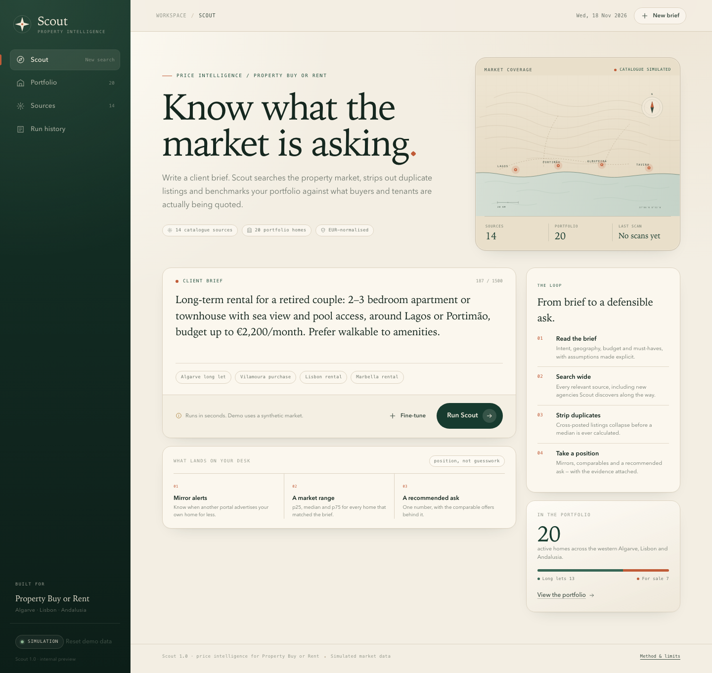
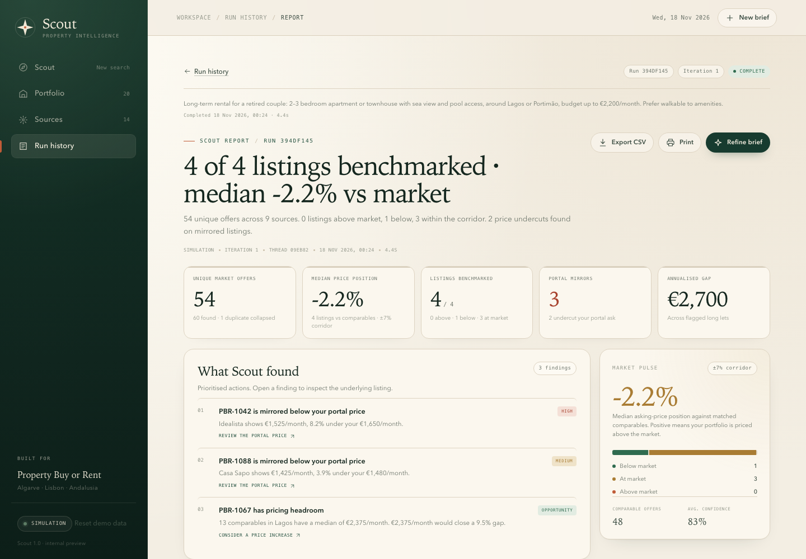
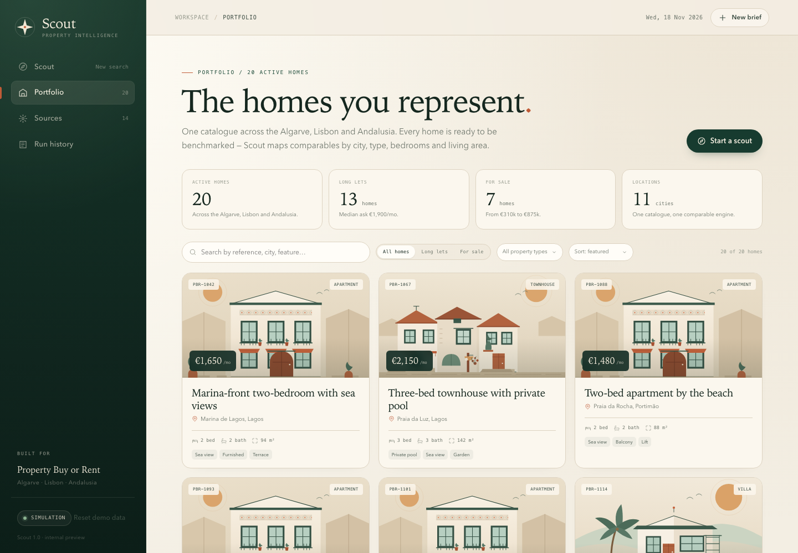

# Scout

**AI price intelligence for Property Buy or Rent.** Scout reads a client brief, searches a property-source catalogue, removes duplicate listings, detects mirrors of the portfolio and benchmarks every matched home against the asking prices it finds.

Built from scratch for the Property Buy or Rent brief: a working agent, a real API, persistent run history and a client-ready interface. It runs locally with **no external dependencies and no network access** in demo mode. Screenshots below are from the simulated demo market.



---

## What is in this repository

| | |
|---|---|
| **Working agent** | Brief interpretation → source planning → search → normalisation → dedupe → matching → benchmark → report. Every step is streamed and persisted. |
| **Demo market** | A deterministic simulated market built around a 20-home portfolio, 14 source domains, 9 searchable sources and a pool of discoverable agencies. No API keys required. |
| **Portfolio** | Long lets and sales across the Algarve, Lisbon and Andalusia, with editorial property artwork, filters and a benchmark drawer. |
| **Source catalogue** | Portals, marketplaces and agencies. Toggle sources, add your own, see what Scout discovered on its last run. |
| **Reports** | KPI cards, prioritised findings, market pulse, p25/median/p75 positioning, an auditable offer ledger, extraction evidence, duplicate groups, CSV/JSON export and print CSS. |
| **Run history** | Threads and iterations, duration, counts, status, reopenable reports, cancellation. |
| **Live mode** | Tavily search, public-page extraction (JSON-LD → OpenGraph → visible text), optional LLM fallback, robots.txt checks and an SSRF guard. |
| **Ops** | SQLite WAL persistence, rate limiting, request validation, CSP, security headers, graceful shutdown, health endpoint, Dockerfile, 31 tests. |



The portfolio view keeps every home one click from the comparable evidence:



---

## Quick start

Requirements: **Node.js 24+** (Node's built-in `node:sqlite` is used).

```bash
cd "search agent"
npm start
```

Open **http://127.0.0.1:4321**. Stop with `Ctrl+C`.

There is no `npm install` step and no dependency tree. Demo mode is selected automatically when no Tavily key is configured.

To reset the demo between audiences:

```bash
curl -X POST http://127.0.0.1:4321/api/demo/reset \
  -H 'Content-Type: application/json' -d '{}'
```

Or use **Reset demo data** at the bottom of the sidebar. This clears runs, offers, matches and discovered sources while keeping the portfolio and seeded catalogue.

---

## A 90-second demo path

The full runbook is in **[DEMO.md](DEMO.md)**. The short version:

1. On **Scout**, point out the brief composer and the market-coverage panel. The default brief is the Algarve long-let search from the client conversation.
2. Press **Run Scout**. Watch the live pipeline: the brief is interpreted, sources are planned, offers are parsed, prices normalised, duplicates collapsed and comparables matched.
3. The report scrolls in. Lead with the headline, then the **findings**: a listing above market, portal mirrors undercutting the portal ask, and a long let with pricing headroom.
4. Open a **Mirror** row in the offer ledger. Show the extracted evidence, confidence and the side-by-side against your own listing. Open a **positioning** row to show the comparable distribution and the suggested ask.
5. Click **Refine brief** and run again; the run is stored as **Iteration 2** under the same thread.
6. Show **Sources** (a new agency was discovered during the run) and **Run history** (the run is auditable and exportable).
7. Close on **Method & limits**: ask prices, not availability; human sign-off; portal terms; where production hardening goes next.

---

## How Scout works

```
Browser (vanilla ES modules, no build step)
  │  fetch + EventSource (SSE)
  ▼
Node HTTP server ──► Orchestrator ──► Provider
  │                     │              ├─ DemoProvider (deterministic synthetic market)
  │                     │              └─ LiveProvider (Tavily + page extraction + optional LLM)
  │                     ├─ normalise prices (FX, weekly/annual → monthly)
  │                     ├─ filter off-brief offers
  │                     ├─ collapse cross-posted duplicates
  │                     ├─ detect mirrors + score comparables
  │                     └─ benchmark + write recommendations
  ▼
SQLite (WAL) — runs, steps, offers, matches, source catalogue
```

### The pipeline

| Phase | What happens |
|---|---|
| **Interpret** | The brief is parsed into transaction, types, locations, bedrooms, budget, requested features and assumptions. Form refinements override the prose. Confidence is shown, never silently assumed. |
| **Plan** | Scout selects relevant enabled sources, builds three query variants per source and adds 1–2 relevant source domains to the catalogue (simulated discovery in demo mode, Tavily discovery in live mode). |
| **Search** | Sources are queried with a small worker pool. One failing portal does not fail the run. Each result is normalised immediately. |
| **Normalise** | Prices are validated, weekly/annual rents are converted to monthly, and non-EUR prices are converted at configured fixed FX rates. Off-brief results are rejected with a counted reason. |
| **Dedupe** | Cross-posted listings collapse into one canonical offer using title keywords, city, type, bedrooms, area bucket and price bucket. The most confident, most reliable copy becomes canonical. |
| **Match** | Mirrors first (same listing), then comparables. Mirrors are identified by reference mentions or title similarity ≥55%, area within 8% and price within 22%. Comparables require the same city and type, bedrooms within one, area 60–160% and a weighted score ≥55. |
| **Benchmark** | Comparable median, p25 and p75. The ±7% corridor separates “at market” from “above” and “below”. The suggested ask is the median rounded to the nearest €25/month or €1,000 for sales. |
| **Report** | Findings are ranked by severity and financial impact. The report is persisted and can be recomputed from SQLite at any time. |

### Price conventions

- All prices are normalised to **EUR** for comparison.
- Long-let prices are monthly; sale prices are totals.
- Fixed demo FX: `EUR 1.00`, `GBP 1.17`, `USD 0.92` (configurable via `SCOUT_FX`).
- Positive “position vs median” means the portfolio listing is **more expensive** than the comparable median.
- “Offer vs your ask” is the market offer compared with the portfolio price; negative values are undercuts.

### What makes the demo defensible

- Duplicates are removed **before** a median is calculated.
- Mirrors are excluded from the comparable set, so a listing never benchmarks itself.
- Every offer has a source, confidence score and extraction snippet.
- Every rejected result has a reason and is counted in search coverage.
- Everything is deterministic in demo mode for the same run id; no random numbers leak into the report without a seed.

---

## Project structure

```text
.
├── package.json              # no dependencies; Node 24+; start / dev / test
├── Dockerfile                # node:24-alpine runtime image
├── .env.example              # configuration reference
├── README.md
├── DEMO.md                   # client demo runbook + Q&A
├── server/
│   ├── index.js              # startup, logging, graceful shutdown
│   ├── app.js                # HTTP API, SSE, static server, security headers
│   ├── config.js             # environment-driven configuration
│   ├── db.js                 # SQLite schema, seeding, persistence
│   ├── seed/data.js          # 20-home portfolio + source catalogue + discovery pool
│   ├── agent/
│   │   ├── orchestrator.js   # streaming pipeline + cancellation
│   │   ├── brief.js          # natural-language brief → structured filters
│   │   ├── provider.js       # provider factory
│   │   ├── mock-provider.js  # deterministic simulated market
│   │   ├── live-provider.js  # Tavily + page extraction + optional LLM
│   │   ├── extract.js        # normalisation and HTML/JSON-LD extraction
│   │   ├── matching.js       # dedupe, mirror detection, comparable scoring
│   │   └── benchmark.js      # positions, findings and report assembly
│   └── lib/                  # errors, validation, FX, stats, safe fetch, robots, CSV
├── public/
│   ├── index.html
│   ├── styles.css
│   ├── assets/               # SVG map, property artwork, favicon
│   └── js/
│       ├── app.js            # hash router, shell, reset flow
│       ├── api.js            # typed API client
│       ├── ui.js             # formatting, icons, drawer, toasts
│       └── views/            # scout, portfolio, sources, runs, report
├── tests/                    # node:test suite (31 tests)
└── data/                     # created at runtime; SQLite lives here
```

The UI is deliberately build-free: native ES modules, one stylesheet and local assets. There is no CDN, remote font or telemetry request.

---

## Configuration

Copy `.env.example` for reference, but **the built-in start script does not load `.env`**. Export variables in your shell, set them in your process manager, or pass them to Docker.

| Variable | Default | Purpose |
|---|---|---|
| `SCOUT_MODE` | `auto` | `auto`, `demo` or `live`. `auto` chooses live when `TAVILY_API_KEY` exists. |
| `PORT` | `4321` | HTTP port. |
| `HOST` | `127.0.0.1` | Bind address. Use `0.0.0.0` in containers. |
| `SCOUT_DB_PATH` | `./data/scout.db` | SQLite path. Created automatically. |
| `SCOUT_STEP_DELAY_MS` | `190` | Simulated agent pacing; use `0` for tests/CI. Live mode ignores it. |
| `SCOUT_MAX_CONCURRENT_RUNS` | `3` | Max queued/running agent runs. |
| `SCOUT_RUNS_PER_MINUTE` | `8` | Per-IP run creation limit. |
| `SCOUT_FX` | `{"EUR":1,"GBP":1.17,"USD":0.92}` | JSON FX rates into EUR. |
| `TAVILY_API_KEY` | — | Required for live mode. |
| `SCOUT_LLM_URL` | — | Optional OpenAI-compatible base URL or `/chat/completions` endpoint. |
| `SCOUT_LLM_KEY` | — | Optional bearer token for the LLM endpoint. |
| `SCOUT_LLM_MODEL` | — | Required with an LLM URL for the fallback extractor. |
| `SCOUT_USER_AGENT` | `ScoutPriceBot/1.0 (+https://propertybuyorrent.com)` | Identifies Scout when fetching pages. |
| `SCOUT_LOG_LEVEL` | `info` | `debug`, `info`, `warn`, `error`. |

Live mode with `SCOUT_MODE=live` and no key exits with a clear configuration error rather than silently simulating.

---

## Live web mode

```bash
export SCOUT_MODE=live
export TAVILY_API_KEY=tvly-...
npm start
```

Live mode:

1. Uses Tavily for discovery and per-source `site:` searches.
2. Fetches only pages on the source's registered domain.
3. Extracts structured data from JSON-LD first, then OpenGraph/price meta tags, then visible-text heuristics.
4. Falls back to an optional OpenAI-compatible model to extract a single listing from difficult pages. Page text is bounded and passed as **untrusted data** with an instruction to ignore embedded instructions.
5. Checks `robots.txt`, caps page fetches at 30 per run and 3 per source, and validates every URL (including redirects) against private-network/SSRF ranges.

**This does not grant permission to scrape a website.** Portal terms of service and licensing take precedence. The client's brief explicitly anticipated that some portals do not permit AI access; production should prefer licensed APIs or feeds where they exist. Availability cannot be verified from asking-price pages and remains a manual check, by design.

The live adapter has been written defensively but was not exercised against third-party portals in this build because no Tavily key or licensed feeds were available. Validate it against your permitted sources and add fixtures before relying on it.

---

## API

All JSON responses use `{ "ok": true, "data": ... }`; errors use
`{ "ok": false, "error": { "code", "message", "details", "requestId" } }`.

| Method | Endpoint | Purpose |
|---|---|---|
| `GET` | `/api/health` | Liveness/readiness. |
| `GET` | `/api/meta` | Mode, version, portfolio/config counts, limits. |
| `GET` | `/api/properties` | Portfolio listing catalogue. |
| `GET` | `/api/sources` | Source catalogue. |
| `POST` | `/api/sources` | Add a source (`name`, `domain`, `kind`, `country`, `region`, `reliability`, `notes`). |
| `PATCH` | `/api/sources/:id` | Update `enabled`, `name`, `kind`, `region`, `notes`, `reliability`. |
| `GET` | `/api/runs?limit=50` | Run ledger. |
| `POST` | `/api/runs` | Start a run. Body: `{ "brief": "...", "overrides": {...}, "threadId": "..." }`. Returns `202` with a queued run. |
| `GET` | `/api/runs/:id` | Run status + all persisted steps. |
| `GET` | `/api/runs/:id/events` | SSE stream: `step` and `done` events; replays persisted steps first. |
| `GET` | `/api/runs/:id/results` | Complete report (positions, offers, duplicates, recommendations). |
| `POST` | `/api/runs/:id/cancel` | Cooperative cancellation. |
| `GET` | `/api/runs/:id/export.csv` | Excel-ready, BOM-prefixed report CSV. |
| `GET` | `/api/runs/:id/export.json` | Full JSON report attachment. |
| `POST` | `/api/demo/reset` | Demo only. Clears runs/offers/matches and non-seeded sources. |

Example:

```bash
curl -s -X POST http://127.0.0.1:4321/api/runs \
  -H 'Content-Type: application/json' \
  -d '{
    "brief": "Long-term rental for a retired couple: 2-3 bedroom apartment or townhouse with sea view and pool access, around Lagos or Portimao, budget up to 2200 euros per month.",
    "overrides": { "location": "Algarve" }
  }'
```

`overrides` accepts `transaction` (`rent`/`sale`), `location`, `budget` (EUR), `bedsMin`, `bedsMax` and `types`. Form overrides always beat the prose. Passing an existing `threadId` creates the next iteration in that search thread.

The API intentionally has **no authentication**. Do not expose it to the public internet without an identity-aware proxy or app-level auth — see below.

---

## Persistence and audit

SQLite (WAL mode) stores:

- `properties` — the portfolio catalogue.
- `sources` — enabled/disabled sources, reliability, discovered-by, use counts.
- `runs` — brief, structured filters, status, phase, progress, stats, timings, thread/iteration.
- `run_steps` — every agent event with elapsed time.
- `offers` — every eligible offer, canonical/duplicate flags, FX-normalised price, confidence, evidence.
- `matches` — offer → portfolio listing, kind, score, delta and reasons.

A report can be rebuilt from persisted offers and matches; the CSV/JSON exports are generated from that record. Run history is intentionally retained until reset; for production, add an explicit retention policy for client briefs (the client’s own answer suggested a few months at most).

---

## Tests

```bash
npm test
```

31 tests run with Node's built-in test runner and cover:

- brief parsing (rent/sale, ranges, T2, GBP conversion, defaults, overrides);
- portfolio scope selection;
- mirror detection, comparable scoring, rejection reasons;
- duplicate collapsing and canonical selection;
- benchmark/statistics functions and FX;
- config resolution, rate limiting and SSRF guards;
- the full HTTP/agent pipeline against a temp SQLite database;
- SSE replay, CSV/JSON export, iterations and source management;
- demo reset behaviour.

The API suite uses `SCOUT_STEP_DELAY_MS=0`; the full suite completes in under a second. No network is required.

---

## Docker

```bash
docker build -t scout .
docker run --rm -p 4321:4321 -v "$PWD/data:/app/data" scout
```

Open http://127.0.0.1:4321. The image runs as the non-root `node` user, stores SQLite in `/app/data`, exposes a health check and defaults to demo mode.

For live mode:

```bash
docker run --rm -p 4321:4321 \
  -e SCOUT_MODE=live \
  -e TAVILY_API_KEY=tvly-... \
  -e SCOUT_USER_AGENT='ScoutPriceBot/1.0 (+https://your-domain.example/contact)' \
  -v "$PWD/data:/app/data" scout
```

Persist `/app/data`; otherwise the SQLite file is lost when the container stops. Put TLS and authentication in front of the service (Caddy, nginx, Cloudflare Access, or an SSO proxy).

---

## Production hardening checklist

This build is a deployable, single-tenant internal application and a client demonstration — not a hardened public SaaS. The following are implemented:

- strict input validation and payload limits;
- CSP, frame denial, MIME sniffing protection and security headers;
- parameterised SQL and no secrets in the browser;
- per-IP rate limits, run caps and cooperative cancellation;
- SSRF protections and robots.txt checks in live mode;
- error sanitisation and request ids;
- structured logs, health endpoint and graceful shutdown;
- WAL persistence, seeded resets and complete run audit trails;
- tests and a dependency-free runtime.

Before exposing it to clients or the public:

1. **Authentication and roles** — staff admin, analyst, client/portal user; server-side authorisation on every route.
2. **Secret management** — Tavily/LLM keys via a vault, not environment files.
3. **Postgres/HA** — SQLite is single-node; move runs/offers to Postgres for concurrency and backups.
4. **Queue/worker** — separate long scans from the web process and add retries/idempotency.
5. **Observability** — metrics, traces, error reporting, per-source success dashboards.
6. **Data governance** — retention, deletion and export policy for client briefs; encryption at rest; DPIA/GDPR review.
7. **Source governance** — manual approval for auto-discovered domains, licensed APIs, terms-of-service register, robots/rate-limit policy.
8. **Availability workflow** — integrate owner/agency confirmations; do not imply asking prices are available stock.
9. **Billing/quotas** — per-tenant search and API spend limits.
10. **CRM integration** — Zoho remains the system of record for clients, partners and workflow. Scout should link searches to Zoho records and write back only the signed-off shortlist, not replace the CRM.
11. **Local LLM path** — the provider abstraction can point at an OpenAI-compatible local runtime; evaluate quality, latency and data residency before switching.

---

## Known limitations

- **Demo data is synthetic.** Every offer, agency, price and listing URL in demo mode is fictional. Portal names are used to make the source catalogue legible; Scout does not contact them in demo mode.
- **Asking prices, not achieved prices.** Scout does not measure negotiated sale prices or void periods.
- **Availability is never verified.** This was an explicit constraint in the client brief.
- **Live extraction is heuristic.** JSON-LD/OpenGraph coverage varies by portal; confidence is an extraction quality signal, not a truth probability.
- **FX is fixed** unless configured or replaced with a live treasury feed.
- **Comparable matching is a model**, not a valuation. Human review is mandatory before repricing.
- **Single-process SQLite** is suitable for the initial 1–2 internal users and demo/pilot volumes, not for a high-concurrency public portal without the changes above.

---

## Handover notes

- The agent is deliberately split at the provider boundary: `DemoProvider` for deterministic demos, `LiveProvider` for web work. Both satisfy the same `prepareRun`/`searchSource` interface, so a licensed portal-feed provider can be added without touching matching or benchmarking.
- To adjust classification rules, start in `server/agent/matching.js` (mirror/comparable) and `server/agent/brief.js` (criteria parsing).
- To adjust finding thresholds, edit `classifyGap` in `server/lib/stats.js` (±7%) and the recommendation logic in `server/agent/benchmark.js`.
- To rebrand, change the tokens in `public/styles.css` and the wordmarks in `public/index.html`.
- For a longer pilot, move the SQLite repositories behind an interface; the schema is small and maps naturally to Postgres.

All property artwork, the Algarve map and the interface were produced for this build. No third-party UI framework, font CDN or analytics service is used.

---

*Scout is a demonstration built for Property Buy or Rent. It is not tax, legal, valuation or financial advice.*
